# BnB-Kiosk Software Design Patterns

Bake'n Brew customer kiosk and staff portal  
Repository version: `0.0.0` (draft) · Reviewed: 2026

This document records the software design patterns implemented in BnB-Kiosk. Each pattern solves a concrete architectural problem in the application rather than adding abstraction for its own sake. Two primary patterns from the project architecture are documented in full (**Observer** and **Repository**), followed by a summary of supporting patterns present in the codebase.

## Contents

- [1. Pattern overview](#1-pattern-overview)
- [2. Primary pattern 1: Observer](#2-primary-pattern-1-observer)
- [3. Primary pattern 2: Repository](#3-primary-pattern-2-repository)
- [4. Supporting patterns in BnB-Kiosk](#4-supporting-patterns-in-bnb-kiosk)

## 1. Pattern overview

| Design pattern | Main purpose | Where used in BnB-Kiosk |
| --- | --- | --- |
| Observer | Notifies dependent UI views when shared order or inventory state changes | `src/stores/staffOrders.ts`, `src/services/staffOrders.ts`, `src/stores/staffProducts.ts`, `src/views/staff/StaffShellView.vue` |
| Repository | Separates data-access logic (Supabase RPC/REST and dev `localStorage`) from UI and business logic | `src/services/orders.ts`, `src/services/staffOrders.ts`, `src/services/staffProducts.ts`, `src/services/staffAuth.ts` |
| Strategy | Makes filtering and sorting algorithms interchangeable behind a shared interface | `src/services/staffRecords.ts` (`isDateInRange` presets and `sortServedItemRows` comparators) |
| Singleton | Controls access to one shared client instance or store state | `src/lib/supabase.ts` (`supabase` client) and Pinia store instances (`src/stores/*.ts`) |
| Factory | Creates configured objects or route trees without tightly coupling callers to concrete definitions | `createStaffRoutes(prefix)` (`src/router/staffRoutes.ts`) and `createAttemptThrottle(...)` (`src/lib/security.ts`) |

## 2. Primary pattern 1: Observer

### 2.1 Pattern name and definition

**Observer (behavioral pattern).** Defines a one-to-many subscription between a subject holding state or emitting events and dependent observers that react automatically whenever that state changes.

### 2.2 Software problem it solves

In the BnB-Kiosk staff portal, multiple views depend on the same live order stream at the same time:

- `StaffShellView.vue` renders the sidebar active-order badge (`ordersStore.activeCount`).
- `StaffQueueView.vue` displays pending, accepted, cooking, and ready cards across three tabs (`waitingOrders`, `cookingOrders`, `readyOrders`).
- `StaffRecordsView.vue` reads `ordersStore.orders` and filters completed orders via `filterCompletedOrdersByDate` to compute totals and CSV export rows.

Orders can change from outside the current component: a customer submits a new kiosk order, another staff terminal advances a card via Supabase Realtime, or a second browser tab updates `localStorage` in local dev preview. Without an Observer subject managing one shared subscription, each view would have to open its own WebSocket channel or `storage` listener, leading to duplicate connections, leaked listeners on unmount, and stale counts between the sidebar badge and the active tab.

### 2.3 Design illustration



Interactive source: [bnb-pattern-observer.html](diagrams/bnb-pattern-observer.html)

### 2.4 Source code implementation

**1. Event source adapter (`src/services/staffOrders.ts`, lines 118 to 144):** wraps Supabase Realtime (`postgres_changes`) and browser `storage` events behind one callback registration API returning an unsubscribe function.

```ts
export function subscribeStaffOrders(onChange: () => void): () => void {
  const client = supabase
  if (client) {
    const channel = client
      .channel('staff-orders-watch')
      .on('postgres_changes', { event: '*', schema: 'public', table: 'orders' }, () => {
        onChange()
      })
      .subscribe()

    return () => {
      void client.removeChannel(channel)
    }
  }

  if (isLocalOrderDemo) {
    const onStorage = (event: StorageEvent) => {
      if (event.key === null || event.key.startsWith(localOrderPrefix)) {
        onChange()
      }
    }
    window.addEventListener('storage', onStorage)
    return () => window.removeEventListener('storage', onStorage)
  }

  return () => {}
}
```

**2. Reference-counted subject (`src/stores/staffOrders.ts`, lines 73 to 89):** opens one live subscription when the first consumer mounts (`subscriberCount === 1`), notifies all reactive Vue observers by updating `orders.value`, and tears down the subscription when the last consumer unmounts (`subscriberCount === 0`).

```ts
function startWatching(): () => void {
  subscriberCount += 1
  if (subscriberCount === 1) {
    void refresh()
    unsubscribeRealtime = subscribeStaffOrders(() => {
      void refresh()
    })
  }

  return () => {
    subscriberCount = Math.max(0, subscriberCount - 1)
    if (subscriberCount === 0 && unsubscribeRealtime) {
      unsubscribeRealtime()
      unsubscribeRealtime = null
    }
  }
}
```

**3. Observer registration in the staff shell (`src/views/staff/StaffShellView.vue`, lines 13 to 21):** subscribes on mount and invokes the cleanup function on unmount.

```ts
let stopWatching: (() => void) | null = null

onMounted(() => {
  stopWatching = ordersStore.startWatching()
})

onUnmounted(() => {
  stopWatching?.()
})
```

The same reference-counted Observer structure is reused in `src/stores/staffProducts.ts` (`startWatching()` + `subscribeStaffProducts`) for `StaffAvailabilityView.vue`.

### 2.5 Walkthrough

1. When an authenticated staff member opens `/queue` (or `/staff/queue`), `StaffShellView.vue` calls `ordersStore.startWatching()` inside `onMounted`.
2. `subscriberCount` transitions from `0` to `1`. The store immediately calls `refresh()` to load current orders and registers a callback with `subscribeStaffOrders`.
3. When a customer submits an order on the kiosk, Supabase Realtime emits a `postgres_changes` event on `public.orders` (or the browser fires a `storage` event in local preview mode).
4. The callback triggers `ordersStore.refresh()`, replacing `orders.value`.
5. Vue's reactivity system notifies every observer reading store state or derived `computed` properties: `StaffShellView.vue` updates `activeCount` on the sidebar badge, `StaffQueueView.vue` re-renders `waitingOrders`, and `StaffRecordsView.vue` re-filters `ordersStore.orders` as soon as an order is marked served.
6. When staff sign out or leave the shell, `onUnmounted` calls `stopWatching()`, decrementing `subscriberCount` to `0` and removing the Supabase Realtime channel or `window` event listener so no listeners leak.

### 2.6 Comparison with alternatives

| Criterion | Chosen: Reference-counted Observer (Pinia + Realtime / `storage`) | Alternative 1: Per-view fixed-interval polling (`setInterval`) | Alternative 2: Manual refresh button only |
| --- | --- | --- | --- |
| Latency on new orders | Near-immediate when Realtime or `storage` fires | Delayed up to the poll interval (for example 2 to 5 seconds) | Stale until staff manually click refresh |
| Network and connection load | One shared subscription per signed-in tab; zero idle traffic | Repeated HTTP requests even when the café is quiet | Minimal traffic, but misses incoming orders |
| Consistency across views | Sidebar badge, queue tabs, and records share one reactive `orders` state | Separate view timers can temporarily disagree | Different tabs hold out-of-sync snapshots |
| Lifecycle safety | `startWatching()` cleanup tears down channels automatically at `subscriberCount === 0` | Easy to forget `clearInterval` across multiple views | Simple, but fails operational kitchen requirements |

Polling is still used intentionally on the public customer tracking page (`OrderStatusView.vue`, every 2.5 seconds) because anonymous customers should not receive broad Realtime table subscriptions; for authenticated staff dashboards, Observer is a better fit because it gives immediate updates with one managed connection.

### 2.7 Test evidence

Executed `npm run test:unit -- --run --reporter=verbose` on `2026-11-23` (Vitest `4.1.12`): all **14 test files / 37 tests passed**.

Tests verifying Observer-driven dashboard updates across mounted views:

- `src/views/__tests__/StaffQueueView.spec.ts` (`1 passed`, 179ms): mounts `StaffShellView` (which calls `ordersStore.startWatching()` on mount and cleans up on unmount) with `StaffQueueView`. Verifies that pending orders submitted via `submitOrder` appear automatically in `WAITING`, cancelling `#002` removes its card and updates the queue, clicking `Proceed` unlocks `Start Cooking`, and clicking `Start Cooking` moves `#001` reactively into the `COOKING` tab.
- `src/views/__tests__/StaffRecordsView.spec.ts` (`1 passed`, 232ms): mounts `StaffShellView` with `StaffRecordsView`, confirming that completed orders loaded through the shared store populate KPI cards (`Items served`, `Total sales`) while excluding cancelled orders.
- `src/views/__tests__/StaffAvailabilityView.spec.ts` (`1 passed`, 258ms): mounts `StaffAvailabilityView` (which calls `productsStore.startWatching()`), verifies quantity adjustments (`-5` twice to `0`), automatic unavailable state updates, filter tab updates, and toast feedback.

```text
 ✓ src/views/__tests__/StaffQueueView.spec.ts > StaffQueueView payment prompt and order lifecycle > requires Proceed or Cancel on pending orders before unlocking Start Cooking 179ms
 ✓ src/views/__tests__/StaffRecordsView.spec.ts > StaffRecordsView > renders KPI summary, filters by order type and search, and excludes cancelled orders 232ms
 ✓ src/views/__tests__/StaffAvailabilityView.spec.ts > StaffAvailabilityView > toggles item availability, adjusts quantity by +/-1 and +/-5, filters, and shows toast 258ms
```

## 3. Primary pattern 2: Repository

### 3.1 Pattern name and definition

**Repository (architectural / data-access pattern).** Encapsulates data retrieval, persistence, and response validation behind a domain-oriented interface so UI components and state stores operate on typed domain objects (`KioskOrder`, `StaffProduct`, `StaffUser`) without knowing how or where records are stored.

### 3.2 Software problem it solves

BnB-Kiosk has to support two distinct persistence mechanisms while keeping the customer and staff UI identical:

1. **Supabase PostgreSQL** in configured environments (calling `create_kiosk_order`, `get_kiosk_order`, `staff_list_orders`, `staff_update_order_status`, `staff_update_product_availability`, and `products` queries).
2. **Same-origin `localStorage`** during Vite development (`import.meta.env.DEV`) so students and reviewers can run end-to-end demos and unit tests without provisioning a live database.
3. **Fail-closed production mode** where missing Supabase credentials return explicit unavailability errors rather than falling back to browser storage.

If Vue components called `supabase.rpc(...)` or `window.localStorage` directly, every view would duplicate environment checks, input validation, `parseOrder` shape checks, error translation, and `navigator.locks` serialization.

### 3.3 Design illustration



Interactive source: [bnb-pattern-repository.html](diagrams/bnb-pattern-repository.html)

### 3.4 Source code implementation

**1. Order repository boundary (`src/services/orders.ts`, line 33 and lines 53 to 124):** exposes `submitOrder` and `getOrder` returning validated `KioskOrder` objects, switching transparently between Supabase RPCs and dev-only `localStorage`.

```ts
export const isLocalOrderDemo = !supabase && import.meta.env.DEV

export async function submitOrder(request: OrderRequest): Promise<KioskOrder> {
  if (supabase) {
    const { data, error } = await supabase.rpc('create_kiosk_order', { p_request: request })
    if (error) throw new Error('Your order could not be sent. Please try again or ask the cashier.')
    return parseOrder(data)
  }
  if (!isLocalOrderDemo)
    throw new Error('Ordering is unavailable. Please ask the cashier for help.')
  const create = () => {
    const existing = window.localStorage.getItem(localPrefix + request.requestId)
    if (existing) return parseOrder(JSON.parse(existing))
    // Validates catalog items, quantities (1..99), calculates totals, persists bnb.demo-order.<requestId>
  }
  return navigator.locks ? navigator.locks.request('bnb-create-order', create) : create()
}
```

**2. Product inventory repository (`src/services/staffProducts.ts`, lines 59 to 64 and 119 to 175):** enforces boundary validation (`validateProductId`, `validateStockQuantity`, zero-stock unavailability rule) before persisting to either `staff_update_product_availability` or `bnb.demo-products`.

```ts
function normalizeUpdate(update: ProductStockUpdate): ProductStockUpdate {
  const quantity = validateStockQuantity(update.quantity)
  // An item with 0 stock cannot remain available.
  const available = quantity === 0 ? false : Boolean(update.available)
  return { available, quantity }
}

export async function updateStaffProductStock(
  productId: string,
  update: ProductStockUpdate,
): Promise<StaffProduct> {
  const id = validateProductId(productId)
  const next = normalizeUpdate(update)

  if (supabase) {
    const { data, error } = await supabase.rpc('staff_update_product_availability', {
      p_id: id,
      p_available: next.available,
      p_quantity: next.quantity,
    })
    if (error || !data) {
      throw new Error(error?.message || 'Unable to update item availability.')
    }
    // Maps RPC payload into typed StaffProduct
  }
  // Dev-only localStorage fallback or fail-closed production error
}
```

### 3.5 Walkthrough

1. A view or Pinia store invokes a repository function using domain inputs (for example `submitOrder(request)` from `CheckoutView.vue` or `updateStaffProductStock(id, update)` from `useStaffProductsStore`).
2. The repository validates inputs at the boundary (`validateProductId`, `validateStockQuantity`, valid lifecycle transitions in `getAllowedNextStatuses`).
3. If `supabase` is configured (`src/lib/supabase.ts`), the repository invokes the parameterized PostgreSQL RPC or PostgREST query and validates the returned JSON via `parseOrder` or typed mappers.
4. If `supabase` is `null` and `import.meta.env.DEV` is true, the repository executes the identical business rules against `localStorage` (using `navigator.locks` for serialized demo order creation and idempotent `requestId` lookups).
5. If `supabase` is `null` in a production build, the repository throws a clear unavailability error instead of silently writing to browser storage.
6. The caller receives a normalized domain object (`KioskOrder`, `StaffProduct`, `StaffUser`) with zero knowledge of SQL table names, RPC parameter prefixes (`p_*`), or `localStorage` key prefixes.

### 3.6 Comparison with alternatives

| Criterion | Chosen: Service Repository (`src/services/*.ts`) | Alternative 1: Direct Supabase / `localStorage` calls inside Vue components | Alternative 2: Full ORM / Active Record class hierarchy |
| --- | --- | --- | --- |
| Separation of concerns | Views and Pinia stores handle rendering and state; services handle persistence and validation | SQL/RPC names, `localStorage` keys, and error parsing leak into `.vue` files | Adds model class boilerplate that fights Vue 3 / Pinia plain reactive objects |
| Testability | Pure Vitest unit tests exercise business rules and local persistence without mocking Supabase internals | Component tests must stub network clients in every view spec | Requires heavy mock repositories or test database containers |
| Production safety | One central `isLocal*Demo` check guarantees production builds fail closed | Easy for a single component to forget the `import.meta.env.DEV` guard | Over-engineered for a static SPA calling 8 Supabase RPCs |
| Maintenance cost | Changing an RPC signature or storage key requires editing one service file | Requires searching and updating every calling view | Extra mapping layer with little payoff in TypeScript interfaces |

### 3.7 Test evidence

Executed `npm run test:unit -- --run --reporter=verbose` on `2026-11-23` (Vitest `4.1.12`):

- `src/services/__tests__/orders.spec.ts` (`10 passed`): proves idempotent `requestId` retries create only one stored order, catalog prices compute server/repository-side totals (`360`), `isOrderConfirmed` gates QR tracking strictly on `confirmed`/`cooking`/`ready`/`completed`, invalid quantities (`0`, `-1`, `0.5`, `100`) are rejected without writing to storage, and unknown tokens throw without creating records.
- `src/services/__tests__/staffOrders.spec.ts` (`2 passed`): proves `listStaffOrders` and `updateStaffOrderStatus` enforce the full lifecycle (`pending -> confirmed -> cooking -> ready -> completed`) and block skipped transitions (`pending -> ready`).
- `src/services/__tests__/staffProducts.spec.ts` (`2 passed`): proves stock updates persist across reloads, `quantity: 0` forces `available: false`, SQL-injection-like product IDs (`best-sellers-1'; DROP TABLE products;--`) are rejected, and out-of-range quantities (`-1`, `1000`) fail validation.
- `src/services/__tests__/staffAuth.spec.ts` (`3 passed`): proves invitation-code checks, salted SHA-256 hashing, duplicate-email rejection, and 5-failure lockout throttling inside the auth repository.

```text
 ✓ src/services/__tests__/orders.spec.ts (10 tests)
 ✓ src/services/__tests__/staffOrders.spec.ts (2 tests)
 ✓ src/services/__tests__/staffProducts.spec.ts (2 tests)
 ✓ src/services/__tests__/staffAuth.spec.ts (3 tests)

 Test Files  14 passed (14)
      Tests  37 passed (37)
```

## 4. Supporting patterns in BnB-Kiosk

Three smaller patterns complement Observer and Repository where specific modules need them:

- **Strategy (`src/services/staffRecords.ts`):** `filterCompletedOrdersByDate(orders, preset, now)` selects date-window predicates (`today`, `week`, `month`, `all`) and `sortServedItemRows(rows, sortBy, direction)` selects column comparators (`orderId`, `item`, `qty`, `orderType`, `amount`, `date`) without duplicating table logic in `StaffRecordsView.vue`. Verified by `src/services/__tests__/staffRecords.spec.ts` (`3 passed`).
- **Singleton (`src/lib/supabase.ts` and `src/stores/*.ts`):** `supabase` is instantiated once at module load from environment variables and shared across all services; Pinia stores (`useStaffAuthStore`, `useStaffOrdersStore`, `useStaffProductsStore`) maintain one shared state instance per app session.
- **Factory (`src/router/staffRoutes.ts` and `src/lib/security.ts`):** `createStaffRoutes(prefix)` generates identical staff routes for either `/` (standalone `dist-staff/` build) or `/staff` (same-origin Vite dev mode), and `createAttemptThrottle(maxAttempts, lockoutMs)` constructs isolated lockout trackers verified by `src/lib/__tests__/security.spec.ts` (`4 passed`).
