# BnB-Kiosk Technical Design Document

Bake'n Brew customer kiosk and staff portal  
Repository version: `0.0.0` (draft) · Reviewed: 2026

This document describes the technical architecture, modules, domain types, data flows, UI token system, design patterns, and implementation decisions for BnB-Kiosk. It complements the [Software Requirements Specification](<Software Requirements Specification.md>) and [Documentation Guide](<Documentation Guide.md>).

## Contents

- [1. System architecture](#1-system-architecture)
- [2. Module descriptions](#2-module-descriptions)
- [3. Class and component structure](#3-class-and-component-structure)
- [4. Data flow](#4-data-flow)
- [5. Design system and UI tokens](#5-design-system-and-ui-tokens)
- [6. Design patterns](#6-design-patterns)
- [7. Significant implementation decisions](#7-significant-implementation-decisions)

## 1. System architecture

BnB-Kiosk builds two isolated Single-Page Applications (SPAs) from one Vue 3, TypeScript, Vite, Pinia, and Vue Router repository: a public customer kiosk (`dist/`) and an authenticated staff portal (`dist-staff/`). Both apps share domain types, validation utilities, service adapters, and Supabase configuration.



Interactive source: [bnb-architecture.html](diagrams/bnb-architecture.html)

### 1.1 Build and deployment topology

A custom Vite plugin (`bnb-app-target` in `vite.config.ts`) inspects `env.mode`:

- Default mode (`npm run build`): uses `/src/main.ts`, titles the page `Bake'n Brew Kiosk`, and emits `dist/`. During `npm run dev` only, `src/main.ts` dynamically imports `src/router/devStaff.ts` inside `if (import.meta.env.DEV)` so `/staff/*` routes run on the same origin as the kiosk for local preview. Production builds tree-shake that import completely.
- Staff mode (`npm run build:staff`, `vite --mode staff`): rewrites `index.html` to boot `/src/staff-main.ts`, titles the page `Bake'n Brew Staff Portal`, and emits `dist-staff/`.

In production, both bundles deploy to separate HTTPS static hosts (such as Vercel, Netlify, or Cloudflare Pages) with SPA fallback (`/*` to `index.html`) pointing to the same Supabase project via `VITE_SUPABASE_URL` and `VITE_SUPABASE_PUBLISHABLE_KEY`.

### 1.2 Backend and persistence modes

`src/lib/supabase.ts` instantiates the Supabase client only when both `VITE_SUPABASE_URL` and `VITE_SUPABASE_PUBLISHABLE_KEY` are present.

- **Configured backend mode:** All kiosk and staff operations call Supabase Auth, parameterized PostgreSQL RPCs, and Supabase Realtime subscriptions defined in [supabase-staff-schema.sql](supabase-staff-schema.sql).
- **Development local preview mode:** When `supabase` is `null` and `import.meta.env.DEV` is true, services store orders (`bnb.demo-order.<requestId>`), staff accounts (`bnb.staff.demo-accounts`), active session (`bnb.staff.demo-session`), and inventory overrides (`bnb.demo-products`) in same-origin `localStorage`.
- **Production fail-closed behavior:** Production builds set `isLocalMenuDemo`, `isLocalOrderDemo`, `isLocalStaffAuthDemo`, and `isLocalStaffProductsDemo` to `false`. Missing Supabase credentials surface explicit unavailability errors instead of falling back to browser storage or static sample data.

## 2. Module descriptions

| Layer / Path | Key files | Responsibility |
| --- | --- | --- |
| Build and bootstrap | `vite.config.ts`, `src/main.ts`, `src/staff-main.ts`, `src/App.vue` | Switches build target between kiosk and staff bundles, loads `Inter Variable` and global CSS, registers Pinia and Vue Router, and mounts dev-only `/staff/*` routes. |
| Routing and guards | `src/router/index.ts`, `src/router/staff.ts`, `src/router/staffRoutes.ts`, `src/router/devStaff.ts` | Defines public kiosk routes (`/`, `/menu`, `/order/:token`), generates prefixed or root staff routes (`/login`, `/register`, `/queue`, `/availability`, `/records`, `/account`), and enforces `requiresStaffAuth` / `staffGuestOnly` navigation guards. |
| Customer views | `src/views/HomeView.vue`, `MenuView.vue`, `CheckoutView.vue`, `OrderStatusView.vue` | Handles Dine-in / Take-out selection, async live catalog loading with loading/empty/retry states, stock-capped cart edits, receipt preview, Cash / E-wallet selection, idempotent order submission, waiting screen, client-side QR rendering, live `Time Elapsed` counter while active, and 2.5-second status polling (stopped on terminal states). |
| Staff views and UI | `src/views/StaffLoginView.vue`, `StaffRegisterView.vue`, `src/views/staff/StaffShellView.vue`, `StaffQueueView.vue`, `StaffAvailabilityView.vue`, `StaffRecordsView.vue`, `StaffAccountView.vue`, `src/components/staff/StaffOrderCard.vue`, `StaffAuthLayout.vue`, `StaffAuthField.vue` | Provides authenticated staff navigation shell, order queue tabs (`WAITING`, `COOKING`, `READY`) with payment confirmation (`Proceed`/`Cancel`), inline error alerts, and stage controls, stock and availability filters, completed-order summaries with CSV export, and profile/avatar/password forms. |
| State stores | `src/stores/staffAuth.ts`, `staffOrders.ts`, `staffProducts.ts` | Manages reactive staff session state, grouped order queues (`waitingOrders`, `cookingOrders`, `readyOrders`, `completedOrders`), inventory counts, mutation error state, and reference-counted live subscriptions. |
| Service adapters | `src/services/products.ts`, `orders.ts`, `staffOrders.ts`, `staffAuth.ts`, `staffProducts.ts`, `staffRecords.ts` | Abstracts Supabase PostgREST / RPC / Auth / Realtime calls and dev `localStorage`/sample equivalents behind typed, validated functions; `staffRecords.ts` contains pure date-filtering, aggregation, sorting, and CSV serialization helpers. |
| Security and client libs | `src/lib/supabase.ts`, `src/lib/security.ts`, `src/lib/format.ts`, `src/data/menu.ts` | Creates the optional Supabase client; centralizes allowlist input validation, control-character stripping, avatar URL sanitization, redirect sanitization, constant-time string comparison, salted SHA-256 hashing, and login attempt throttling; provides cached PHP currency and `HH:MM:SS` elapsed-duration formatters; holds category ordering, local photo paths, promotion banner copy, and dev-only sample menu items. |
| Database schema & seed | `docs/supabase-staff-schema.sql`, `docs/supabase-menu-seed.sql` | Defines PostgreSQL tables (`staff_invitations`, `staff_profiles`, `products`, `orders`, `order_items`), `kiosk_queue_number_seq`, `on_auth_user_created_staff` signup trigger, Realtime publication (`orders` and `products`), Row Level Security policies, 8 `SECURITY DEFINER` RPCs (including duplicate-item validation and stock deduction on order confirmation), and the 57-item menu catalog seed. |
| Automated tests | `src/**/__tests__/*.spec.ts`, `e2e/order-confirmation.spec.ts`, `vitest.config.ts` | Vitest unit and component suites (isolated from `.env.local` in `vitest.config.ts`) for security, customer product API, services, and views, plus Playwright end-to-end tests verifying reload persistence, separate-actor confirmation, QR tracking, and missing-order handling. |

## 3. Class and component structure

### 3.1 Core domain types, services, and Pinia stores



Interactive source: [bnb-domain-classes.html](diagrams/bnb-domain-classes.html)

Primary TypeScript contracts and their database mappings:

- `KioskOrder` (`src/services/orders.ts`) maps to `public.orders` joined with `public.order_items` via `serialize_kiosk_order(p_order_id)`. Its `status` field is constrained to `'pending' | 'confirmed' | 'cooking' | 'ready' | 'completed' | 'rejected'`.
- `OrderItem` (`src/services/orders.ts`) represents each line item (`id`, `name`, `quantity`, `lineTotal`) composed inside a `KioskOrder` and linked by `product_id` to `public.products`.
- `StaffUser` (`src/services/staffAuth.ts`) maps Supabase Auth user metadata and `public.staff_profiles` fields (`firstName`, `lastName`, `middleInitial`, `homeAddress`, `avatarUrl`, `role`, `joinedAt`, `previousLoginAt`).
- `Product` and `ProductCategory` (`src/services/products.ts`) map validated `public.products` rows (`id`, `category_id`, `name`, `price`, `available`, `stock_quantity`) into grouped kiosk menu categories with local image lookups and effective `available = row.available && row.stock_quantity > 0`.
- `StaffProduct` (`src/services/staffProducts.ts`) represents staff inventory entries (`id`, `categoryId`, `categoryName`, `name`, `price`, `available`, `quantity`).
- `ServedItemRow` and `ServedRecordsSummary` (`src/services/staffRecords.ts`) flatten `completed` orders into per-item table rows and summary card metrics (`itemsServed`, `completedOrderCount`, `totalSales`, `bestSeller`).

### 3.2 Vue component composition

Customer kiosk component tree:

```text
App.vue
└── RouterView
    ├── HomeView.vue                 (/)
    ├── MenuView.vue                 (/menu)
    │   ├── native <dialog>          (order review & quantity edits)
    │   └── CheckoutView.vue         (receipt preview, payment method, Confirm Order)
    └── OrderStatusView.vue          (/order/:token?kiosk=1 or /order/:token)
```

Staff portal component tree:

```text
App.vue
└── RouterView
    ├── StaffLoginView.vue           (/login or /staff/login)
    │   └── StaffAuthLayout.vue + StaffAuthField.vue
    ├── StaffRegisterView.vue        (/register or /staff/register)
    │   └── StaffAuthLayout.vue + StaffAuthField.vue
    └── StaffShellView.vue           (authenticated shell; calls staffOrders.startWatching())
        └── RouterView
            ├── StaffQueueView.vue        (/queue)
            │   └── StaffOrderCard.vue    (per-order card, elapsed timer, item checklist, stage button)
            ├── StaffAvailabilityView.vue (/availability; calls staffProducts.startWatching())
            ├── StaffRecordsView.vue      (/records; reads orders from staffOrders and filters completed orders)
            └── StaffAccountView.vue      (/account; reads/updates staffAuth store)
```

## 4. Data flow



Interactive source: [bnb-data-flow.html](diagrams/bnb-data-flow.html)

### 4.1 Order submission and cashier confirmation

1. **Live menu and cart:** On mount, `MenuView.vue` calls `listMenuProducts()` (`src/services/products.ts`), which fetches `public.products` with a 10-second `AbortController` timeout, validates each row, maps local images from `src/data/menu.ts`, and marks zero-stock items unavailable. `MenuView.vue` caps quantities at `Math.min(99, item.stockQuantity ?? 99)` and computes `subtotal` and `total` (with `discount = 0`). Clicking `Proceed to Checkout` mounts `CheckoutView.vue`, which holds a client-generated `requestId` UUID per checkout attempt.
2. **Idempotent creation:** `submitOrder(request)` calls `supabase.rpc('create_kiosk_order', { p_request })` (or acquires `navigator.locks` in dev mode). PostgreSQL checks `orders.request_id`: retries return the existing serialized order; new requests reject duplicate product IDs, validate items against `public.products` (`available = true` and `stock_quantity >= quantity`), compute totals server-side, assign `queue_number` from `kiosk_queue_number_seq`, generate an unguessable UUID `token`, and persist `status = 'pending'`.
3. **Waiting and polling:** The kiosk saves the active token in `sessionStorage` (`bnb.active-order`) and navigates to `/order/<token>?kiosk=1`. `OrderStatusView.vue` displays a live `Time Elapsed` counter (`formatElapsedDuration`) while the order is active and polls `getOrder(token)` every 2.5 seconds using an in-flight lock (`refreshing`) and unmount flag (`alive`), stopping both polling and the clock once the order reaches a terminal status (`completed` or `rejected`). Network errors preserve the last known `order` state and keep retrying.
4. **Cashier verification gate and stock deduction:** `StaffShellView.vue` keeps `useStaffOrdersStore.startWatching()` active via Supabase Realtime (`postgres_changes` on `public.orders`) or `window` `storage` events in dev preview. In `StaffQueueView.vue`, cashiers check `Paid & receipt issued?` and click `Proceed` (`pending -> confirmed`) or `Cancel` (`pending -> rejected`). On `confirmed`, `staff_update_order_status` locks the ordered `public.products` rows (`FOR UPDATE`), verifies sufficient stock (raising an error surfaced in `.queue-error` if short), deducts `stock_quantity`, and sets `available = false` if remaining stock hits `0`.
5. **QR unlock and tracking:** When `OrderStatusView.vue` observes `isOrderConfirmed(order)` (`confirmed`, `cooking`, `ready`, or `completed`) on a kiosk session, it renders a 480px PNG data-URL QR code locally via `qrcode` pointing to `/order/<token>`. Clicking `Done` removes `bnb.active-order` from `sessionStorage` and returns to `/` without modifying the order.

### 4.2 Preparation stages, inventory, and sales records

- **Stage transitions:** `StaffOrderCard.vue` emits `advance` to `StaffQueueView.vue`, which calls `staffOrdersStore.setOrderStatus(token, nextStatus)`. Both `staffOrders.ts` and `staff_update_order_status` enforce strict transitions: `confirmed -> cooking -> ready -> completed`.
- **Inventory updates:** `StaffAvailabilityView.vue` subscribes to `public.products` via `staffProductsStore.startWatching()` (receiving Realtime updates after manual edits or order-acceptance stock deductions) and saves edits via `staffProductsStore.updateProduct(id, { available, quantity })`. Both `staffProducts.ts` (`normalizeUpdate`) and `staff_update_product_availability` enforce `0 <= quantity <= 999` and force `available = false` whenever `quantity === 0`.
- **Records and CSV export:** `StaffRecordsView.vue` reads `staffOrdersStore.orders`, passes them through pure functions in `src/services/staffRecords.ts` (`filterCompletedOrdersByDate`, `buildServedItemRows`, `summarizeServedRecords`, `sortServedItemRows`), and serializes the active filtered rows with `buildRecordsCsv`.

## 5. Design system and UI tokens

The visual design follows the Bake'n Brew Figma layouts stored in `ordering system/` and uses bundled `Inter Variable` typography (`@fontsource-variable/inter`). Following a three-layer token model (`Primitive -> Semantic -> Component`), the current codebase values map as follows:

### 5.1 Token architecture

| Layer | Token / Role | Current value(s) | Usage |
| --- | --- | --- | --- |
| Primitive | Warm surfaces | `#ffffff`, `#f8f8f6`, `#f9f3dd` | Card backgrounds, staff workspace canvas, warm highlights |
| Primitive | Olive brand ramp | `#617900`, `#5d7706`, `#465800`, `#405909` | Selection fill, staff sidebar, primary actions, hover/active states |
| Primitive | Neutrals | `#0b0c08`, `#111111`, `#5f5e5a` | Primary text, headings, secondary metadata |
| Primitive | Status hues | `#925713` (amber), `#8f2419` / `#fdf1ef` (red) | Cooking stage emphasis, cancel/error text and soft alert fill |
| Semantic | Base typography and surface resets | Defined in `src/assets/base.css` | Base document surface (`#ffffff`), text color (`#2c3e50`), and form font inheritance |
| Component | Sidebar, order card, auth field, action buttons | Scoped styles in `StaffShellView.vue`, `StaffOrderCard.vue`, `MenuView.vue`, `OrderStatusView.vue` | 162px sticky olive sidebar on desktop, top bar on narrow screens, pill queue/elapsed badges, hairline dividers |

### 5.2 Interactive component states

| Control group | Default | Hover / Focus | Active / Busy | Disabled |
| --- | --- | --- | --- | --- |
| Primary CTA (`View my order`, `Confirm Order`, `Proceed`, `Save Changes`) | Olive fill (`#5d7706` / `#465800`), light text | Darker olive (`#405909`), visible focus ring | In-flight guard disables repeat clicks | Muted surface; blocked while cart is empty or form has no valid changes |
| Destructive CTA (`Cancel Order`, `Cancel` pending order) | Soft red tint (`#fdf1ef`) or outline with `#8f2419` text | Higher-contrast red border/fill | Disabled while status mutation runs | Disabled during concurrent requests |
| Stage action (`Start Cooking`, `Mark Ready`, `Mark Served`) | Card-width stage button driven by `actionConfig` | Hover elevation/darken | `busy` prop locks card actions | Hidden for `pending`, `completed`, and `rejected` |

Current token debt: Unused Vue starter variables (`--vt-c-*`) were removed from `src/assets/base.css`, while Bake'n Brew's olive, cream, and status hex values remain declared inside component `<style scoped>` blocks. Extracting those hex values into shared `--bnb-*` primitive and semantic CSS custom properties in `src/assets/base.css` is the next cleanup step if theming or dark mode is added later.

## 6. Design patterns

- **Adapter pattern (dual backend):** Every service module (`products.ts`, `orders.ts`, `staffOrders.ts`, `staffAuth.ts`, `staffProducts.ts`) branches internally on `if (supabase)` vs. `if (isLocal*Demo)` while exposing one identical async TypeScript contract to stores and views. Views never import `@supabase/supabase-js` or read `localStorage` keys directly (aside from the kiosk's active-order `sessionStorage` pointer).
- **Finite State Machine (FSM):** The order lifecycle is modeled as a strict directed transition map (`allowedTransitions` in `staffOrders.ts` and `v_valid` in `staff_update_order_status`), preventing skipped stages (such as jumping from `pending` directly to `cooking`) or reviving terminal states (`completed`, `rejected`).
- **Reference-counted Observer:** `useStaffOrdersStore` and `useStaffProductsStore` track `subscriberCount` inside `startWatching()`, opening one Realtime channel or `storage` listener on the first mount and removing it when the count drops to zero.
- **Route Factory and Guard Decorator:** `createStaffRoutes(prefix)` builds the same route hierarchy for both `/` (standalone staff bundle) and `/staff` (dev same-origin bundle), paired with `installStaffAuthGuard(router)` which deduplicates initial session checks via a shared `initPromise` in `useStaffAuthStore`.
- **Idempotent Command:** Every checkout submission attaches a stable client UUID (`requestId`) enforced by a `UNIQUE` index on `public.orders(request_id)` so retries or double-clicks return the first created order instead of inserting duplicates.
- **Centralized Security Boundary:** `src/lib/security.ts` groups allowlist regex validators, control-character stripping, open-redirect blocking (`sanitizeInternalRedirect`), constant-time string comparison (`timingSafeEqualString`), salted SHA-256 hashing (`hashSecretWithSalt`), and per-email login throttling (`createAttemptThrottle(5, 60_000)`).

## 7. Significant implementation decisions

| Decision | Chosen approach | Rationale and trade-offs |
| --- | --- | --- |
| Two separate SPAs from one repo | Custom Vite plugin (`bnb-app-target`) emitting `dist/` and `dist-staff/`, with dev-only `/staff/*` mounting via `import.meta.env.DEV` | Shares TypeScript types, validation, and services with zero code duplication while keeping staff routes and staff code out of the production kiosk bundle. Requires configuring two deployment targets sharing the same Supabase env vars. |
| No localStorage fallback in production | `isLocal*Demo = !supabase && import.meta.env.DEV` | Prevents a misconfigured production deployment from silently writing real customer orders to browser storage where staff cannot see them. Local preview works only in Vite dev mode on one origin. |
| Cashier confirmation gate instead of payment gateway | `pending -> confirmed` requires an authenticated staff click on `Proceed` | Stops unpaid orders from entering the kitchen without requiring live GCash/Maya merchant integrations during a school project. Trade-off: cashiers must verify Cash or E-wallet payment manually. |
| Parameterized `SECURITY DEFINER` RPCs + `REVOKE ALL` + RLS | Revoke direct table privileges, restrict staff RPCs via `is_active_staff()`, and expose only `create_kiosk_order` and `get_kiosk_order` to `anon` | Eliminates dynamic SQL injection, prevents client-supplied price/total tampering, and restricts public reads to a single unguessable UUID `token`. Trade-off: schema changes require applying SQL updates to Supabase manually. |
| 2.5s polling for kiosk tracking vs. Realtime for staff | `OrderStatusView.vue` polls `get_kiosk_order`; staff stores subscribe to Supabase Realtime | Keeps anonymous kiosk clients scoped to one token-gated RPC without granting broad Realtime table read access, while giving authenticated staff instant queue updates. |
| Live Supabase menu with local image/order metadata (`src/services/products.ts` + `src/data/menu.ts`) | Kiosk fetches `public.products` on mount with a 10s `AbortController` timeout and strict row validation; `menu.ts` supplies category order, local photos, and dev-only sample fallback | Synchronizes prices, availability, and stock limits from Supabase without fabricating photos for new DB products or holding anonymous Realtime channels. Trade-off: an open kiosk screen refreshes catalog changes on load or retry rather than live push, and `docs/supabase-menu-seed.sql` must be run once to seed `public.products`. |
| Local QR rendering and bundled fonts | `qrcode` package renders PNG data URLs in browser; `@fontsource-variable/inter` bundles fonts | Avoids external QR APIs and font CDN outages on café networks and keeps tracking URLs private to the browser. Slightly increases bundle size. |
| CSV formula neutralization and client-side login throttling | `escapeCsvCell` prefixes `=`, `+`, `-`, `@`, `\t`, `\r` with `'`; `createAttemptThrottle` locks after 5 failures for 60s | Protects staff exporting sales CSVs into Excel or Sheets from formula injection and slows brute-force login attempts even in local dev mode. Server-side rate limiting remains Supabase Auth's responsibility in production. |
