# BnB-Kiosk User Manual

**Bake'n Brew · Customer kiosk and staff portal**  
Repository version: **0.0.0** (draft) · Manual revision: **1** · Reviewed: **2026**

This manual explains how customers place and track orders, and how staff manage orders, availability, records, and their account. It describes the current application.

Names, email addresses, orders, and sales figures shown are sample data; your values will differ.

## Contents

- [Before you begin](#before-you-begin)
- [Customer guide](#customer-guide)
- [Staff guide](#staff-guide)
- [Troubleshooting](#troubleshooting)

## Before you begin

Ask the person running the demonstration to start the application and provide its browser address. Keep the application server running while using the kiosk. Installation and startup instructions are in the [Documentation Guide](<Documentation Guide.md>).

Customers use the welcome page and do not need an account. Staff use the staff sign-in page at `/staff/login` and need a registered account. For example, if the running app is at `http://127.0.0.1:5174/`, the sign-in address is `http://127.0.0.1:5174/staff/login`. Use the actual address supplied for your session.

For a simple local demonstration, open the customer and staff pages in **two tabs of the same browser, using the same address and port**. Switching tabs lets one person demonstrate both roles. A different browser, private window, or port has separate local data.

On a touch screen, tap controls. With a mouse, click them. Scroll down when a button or the rest of a form is below the visible area.

## Customer guide

### 1. Choose dine-in or take-out

On the welcome screen, choose **Dine-in** to eat at the café or **Take-out** to take the order away. The menu opens with your chosen order type.

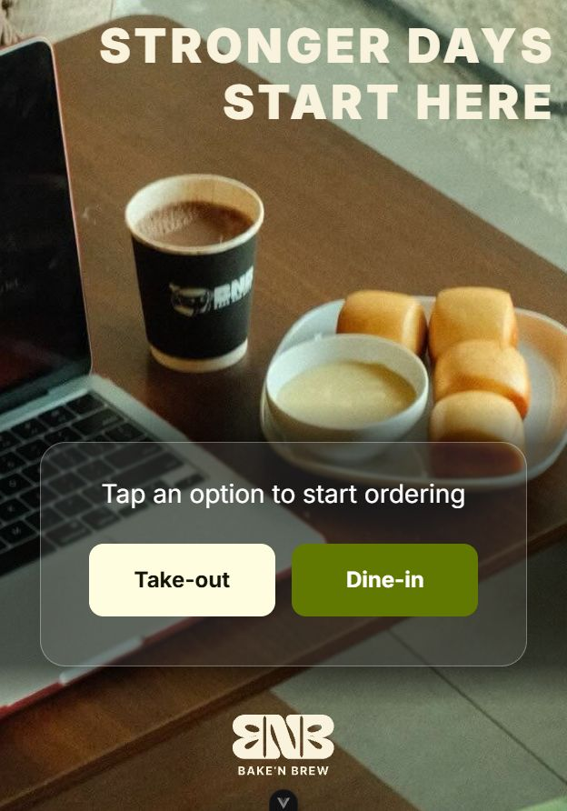

### 2. Browse the menu and add items

1. Select a category, such as **Best Sellers**, **Starter**, or **Rice Meals**, to move to that section.
2. Review the item names, photos, and prices.
3. Use an item's **Add to order** button to add it to your order. Select it again for another quantity.
4. Select **View my order** at the bottom to review your choices.

The running total changes as you add items. **View my order** is unavailable while the order is empty.

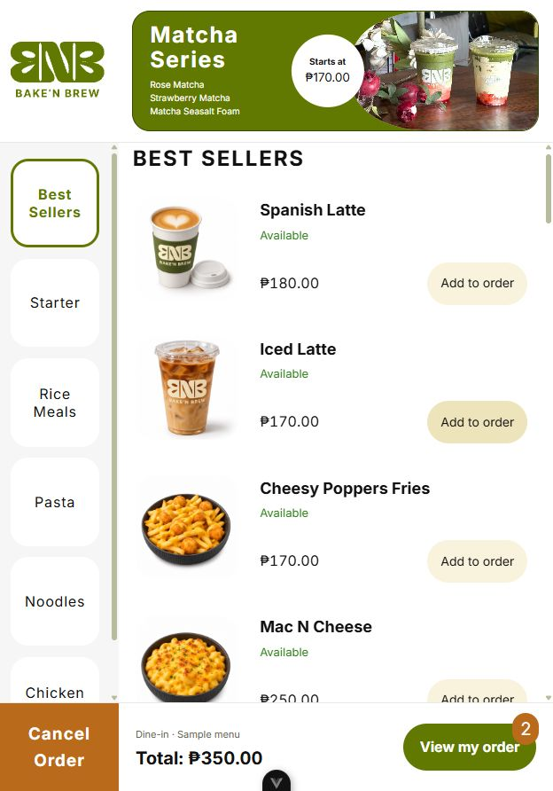

### 3. Review or change the order

1. Check the items and their quantities.
2. Use **+** or **−** beside an item to change its quantity. Reducing it to zero removes it.
3. Check the subtotal, discount, and total.
4. Choose **Add more** to return to the menu, or **Proceed to Checkout** to continue.

To abandon an order before submitting it, return to the menu and choose **Cancel Order**.

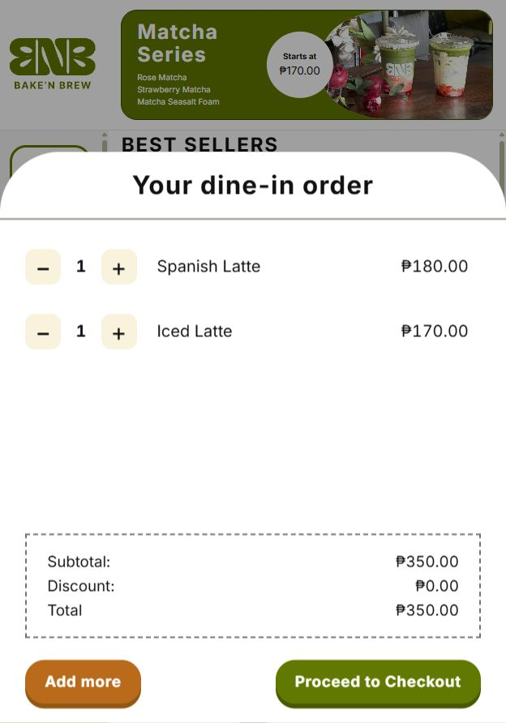

### 4. Select payment and confirm

Check the **Receipt Preview**. Use **Back to order** if you need to change the items.

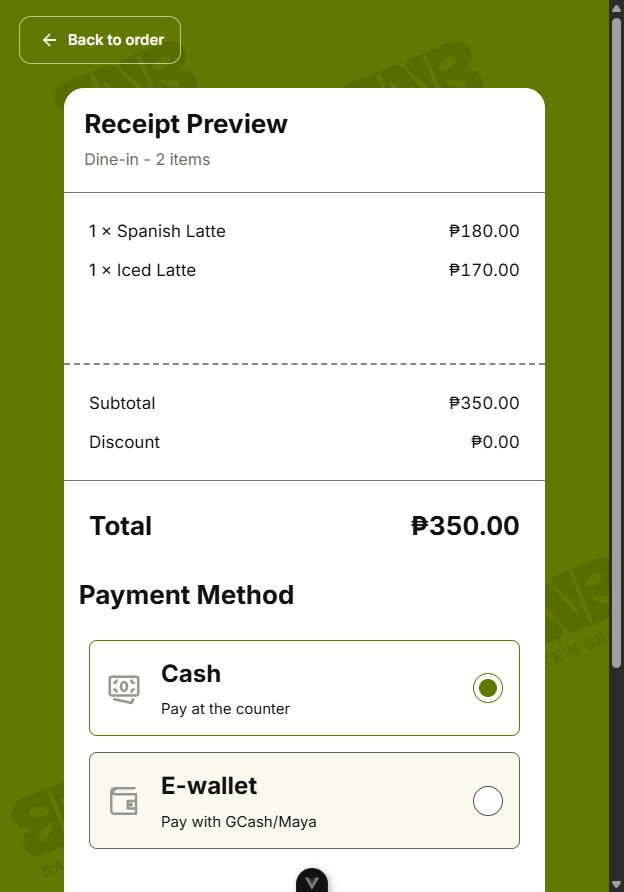

1. Select **Cash** or **E-wallet** under **Payment Method**.
2. Scroll down if needed, then select **Confirm Order** once.
3. Wait for the confirmation/payment screen. Your order has now been sent to staff.

Choosing a payment method alone does not submit the order. Selecting E-wallet does not charge a wallet or open a payment service. Follow the cashier's payment instructions.

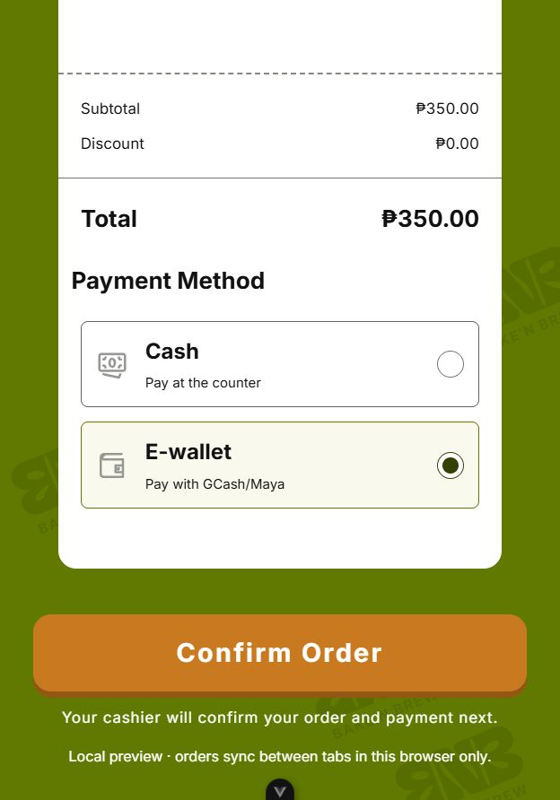

### 5. Wait for cashier confirmation

The screen displays **Waiting for confirmation/payment**, your order reference, payment method, and total.

- **Cash:** pay at the counter.
- **E-wallet:** follow the cashier's instructions and show your GCash/Maya payment to the cashier, as requested on screen.

The cashier must accept the order. The tracking QR code appears automatically afterward. The order does not start cooking just because this waiting screen is displayed.

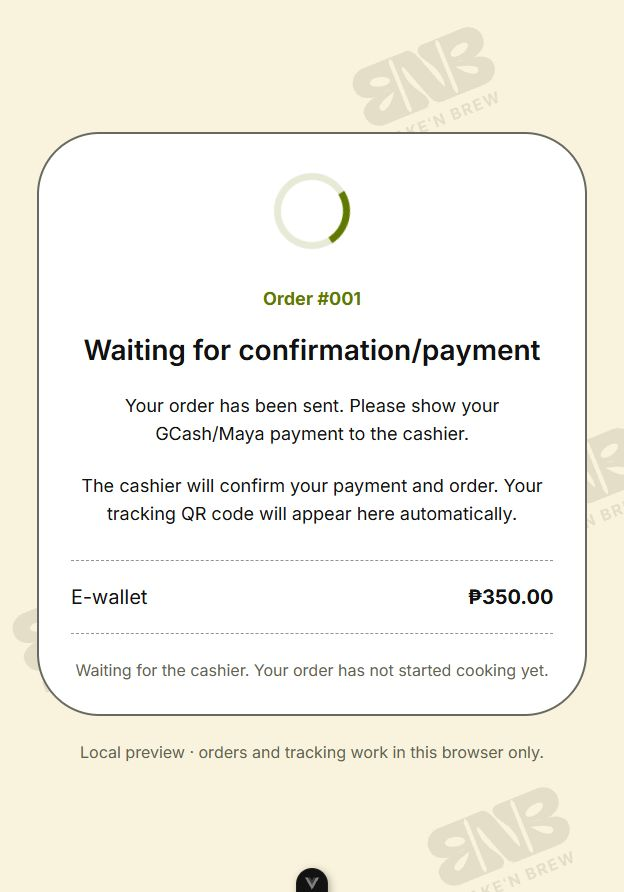

### 6. Note the queue number and open tracking

After acceptance, the kiosk shows your **Queue Number** and a tracking QR code. Remember the number so staff can identify your order.

The QR code opens **order tracking**. It is not a payment QR code. For the local demonstration, click the QR code to open tracking in the same browser; scanning it with a phone does not share the demo's local order data.

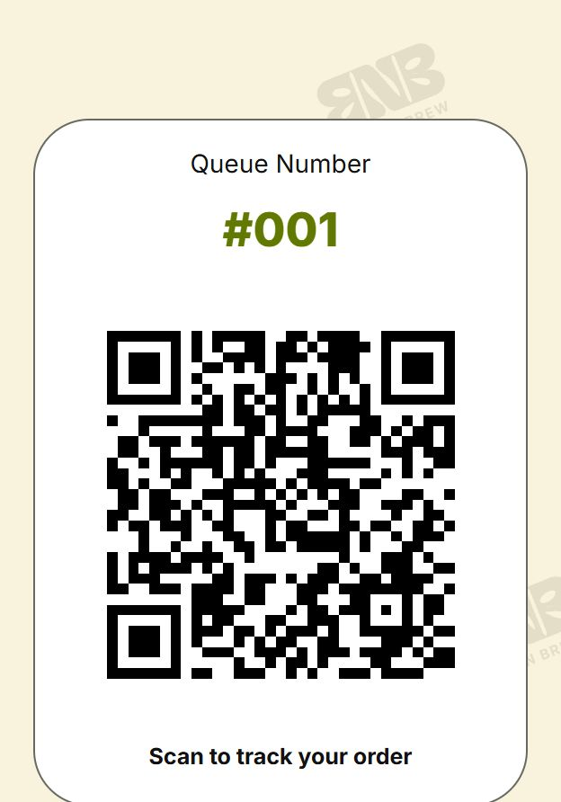

On the kiosk's queue-number page, scroll down to find these actions:

- **Have Feedback?** displays an instruction to share feedback with staff when collecting your order. It does not submit a feedback form.
- **Done** returns the kiosk to the welcome screen for the next customer. It does not cancel the submitted order.

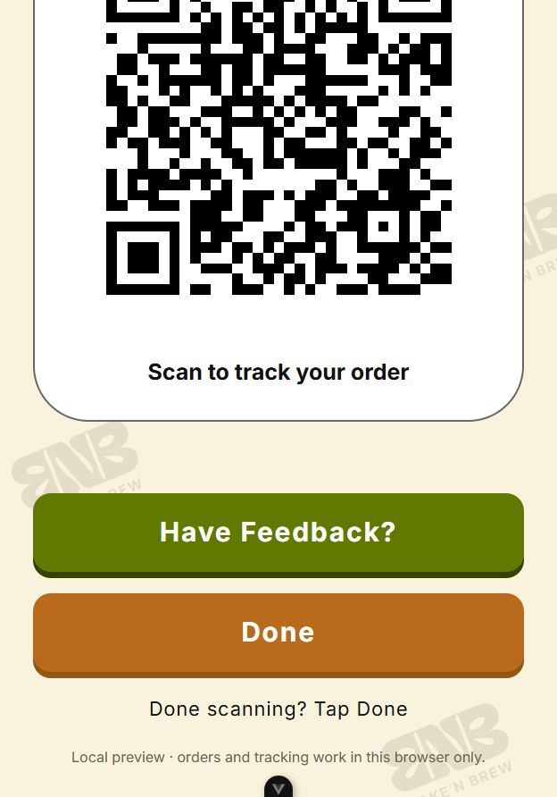

### 7. Follow order progress

The tracking page updates as staff change the order status.

| Status    | Meaning                                 |
| --------- | --------------------------------------- |
| Confirmed | Staff accepted the order.               |
| Cooking   | Staff started preparation.              |
| Ready     | The order is ready to collect or serve. |
| Completed | Staff marked the order as served.       |

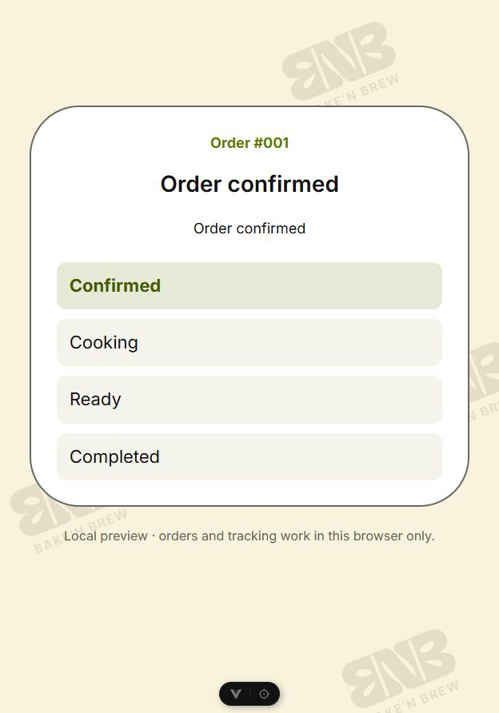

When the page says **Your order is ready**, approach staff and give your queue number.

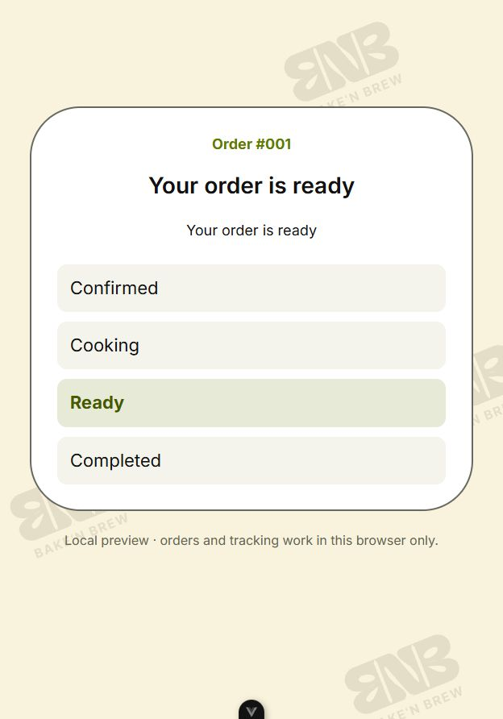

### If the order needs attention

If staff cancel a pending order, the kiosk displays **Please see the cashier**. Speak with the cashier before ordering again. Select **Done** to return to the welcome screen when appropriate.

Customers cannot edit a submitted order through these screens. Ask the cashier for help with corrections.

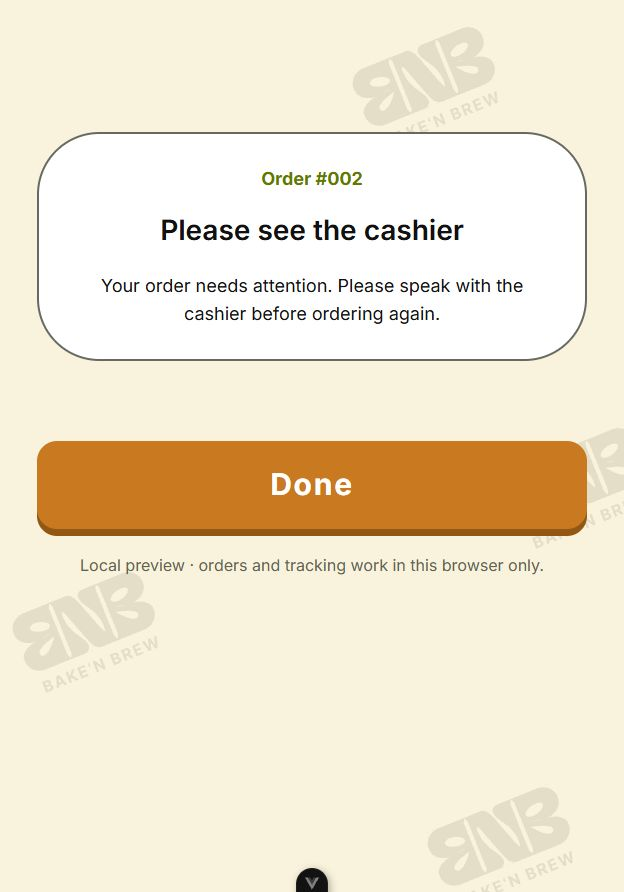

## Staff guide

### 1. Sign in or register

Open `/staff/login` using the running application's address.

1. Enter your **Email Address** and **Password**.
2. Use the password visibility control if you need to check your entry.
3. Select **Login**. Successful sign-in opens the order queue.

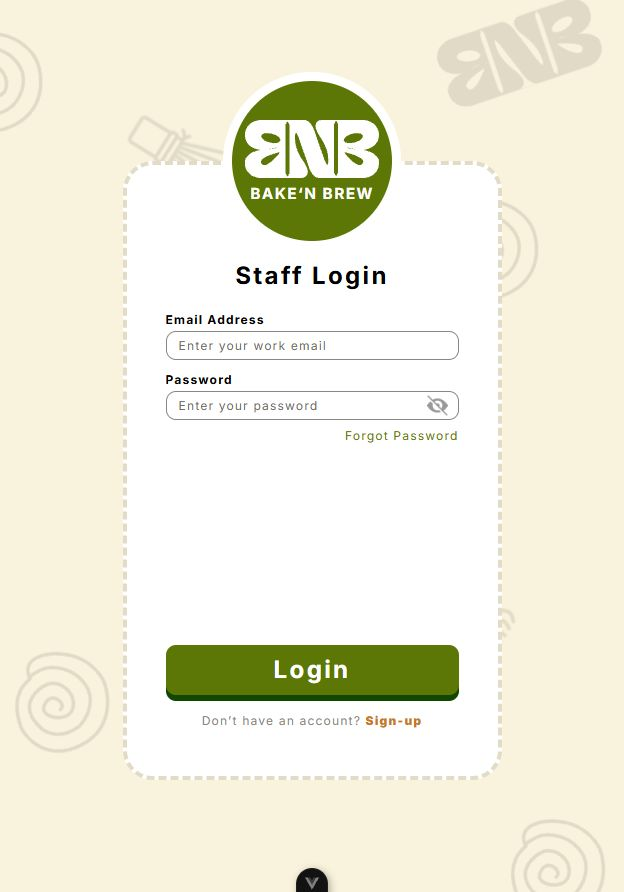

For a new account, select **Sign-up** and complete the registration form:

1. Enter your full name, email address, and staff invitation code.
2. Create and confirm a password containing at least eight characters, including a letter and a number.
3. Select **Create account** and follow the on-screen result. If email verification is required, complete it before signing in.

Obtain the invitation code from the person managing the project. The local preview uses development accounts; registering there does not create a shared online account.

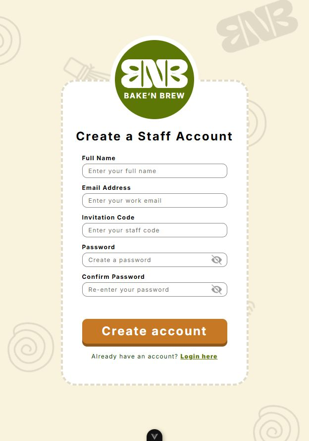

If you forget your password, enter your email on the login page and select **Forgot Password**. Email recovery requires a configured authentication service. The local preview displays a message but does not send a recovery email.

### 2. Find your way around

The staff navigation appears across the top on the narrow screen shown in this manual, and beside the content on wider screens.

| Control   | Use                                                   |
| --------- | ----------------------------------------------------- |
| Orders    | Review incoming orders and update preparation stages. |
| Available | Change staff inventory quantities and availability.   |
| Record    | Review served items, sales, and CSV exports.          |
| Account   | Edit your profile, avatar, or password.               |
| Log Out   | End your staff session.                               |

### 3. Review a new order

1. Open **Orders**, then select **WAITING**.
2. Find the order by its queue number. Check the order type, payment method, items, quantities, and total.
3. Complete the cashier's payment and receipt check shown as **Paid & receipt issued?**
4. Select **Proceed** to accept the order, or **Cancel** if it cannot proceed.

Accepting the order makes the customer's tracking QR code available. Cancelling it displays the cashier-attention message to the customer. Check the correct queue number before either action.

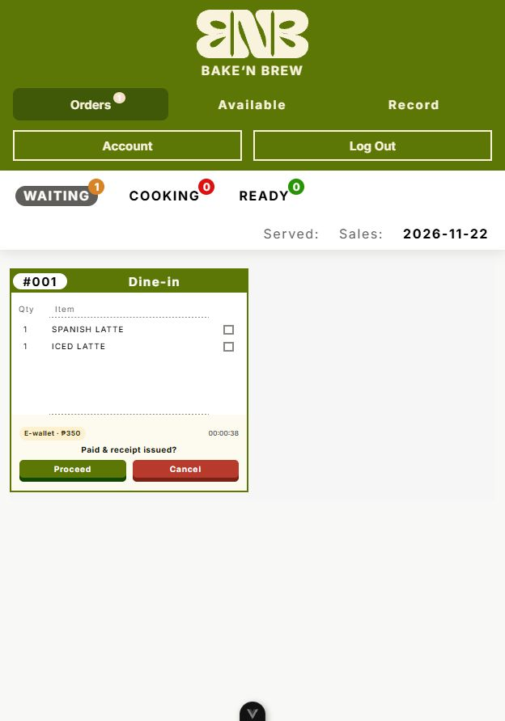

### 4. Update preparation stages

Use the action on each order card when the corresponding work has been done.

| Queue tab | Order state                  | Action        | Result                                                       |
| --------- | ---------------------------- | ------------- | ------------------------------------------------------------ |
| WAITING   | Accepted                     | Start Cooking | Moves the order to COOKING.                                  |
| COOKING   | Being prepared               | Mark Ready    | Moves the order to READY and updates customer tracking.      |
| READY     | Ready for collection/service | Mark Served   | Completes the order and includes it in served-order records. |

The **WAITING** tab contains both incoming orders awaiting acceptance and accepted orders awaiting preparation. The available buttons distinguish them.

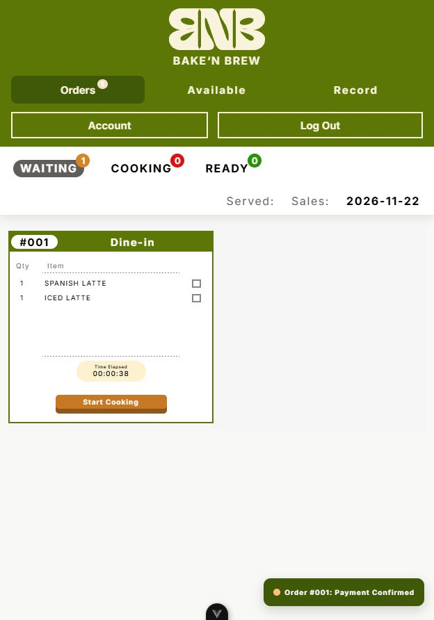

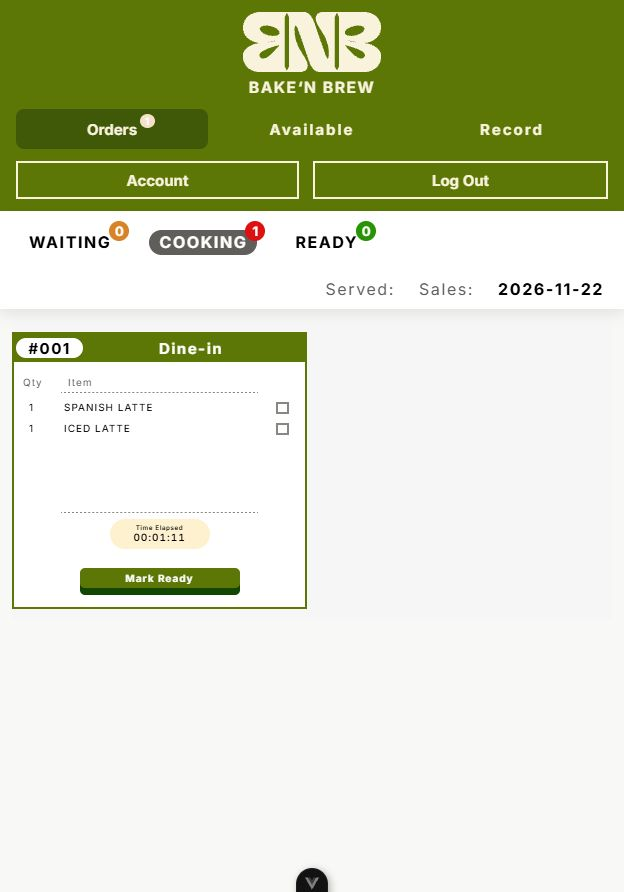

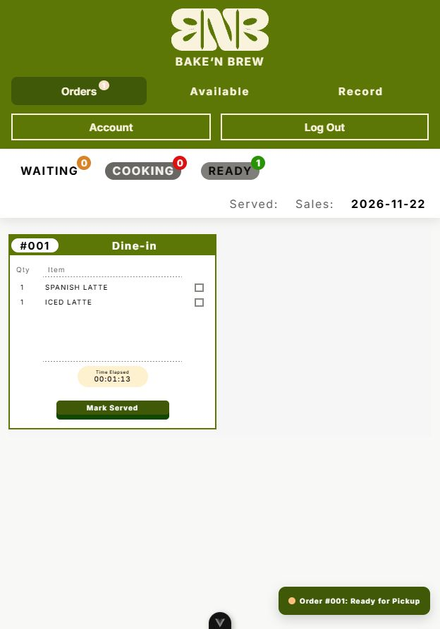

Item checkboxes can help mark individual items as prepared on the current card. They do not automatically advance the order, and these checks are not retained after reloading. Use the stage buttons to update progress.

### 5. Manage staff inventory

1. Select **Available**.
2. Search by item or category name, or choose **All items**, **Available**, or **Unavailable**.
3. Use **−5**, **−**, **+**, or **+5** to adjust an item's stock.
4. Use its **Yes/No** control to change availability.

Stock cannot go below zero. Zero stock makes an item unavailable. Increasing stock makes it available; switching a zero-stock item to available sets its quantity to one. Check the displayed quantity and availability after making changes.

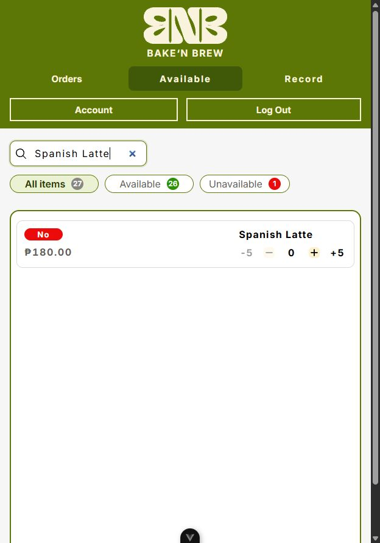

**Current limitation:** this page manages the staff inventory list. The customer kiosk currently uses a separate sample menu, so staff availability changes do not automatically disable that item on the customer menu. Confirm actual availability with the customer when handling an order.

### 6. Review records and export CSV

Select **Record** to open **Order records**. Only completed/served orders contribute to the served-item records and sales summary; cancelled orders are excluded.

1. Select a date range: **Today**, **This week**, **This month**, or **All time**.
2. Review **Items served**, the completed-order count, **Total sales**, and **Best-selling item**.
3. Search for an order ID or item and/or select an order type to narrow the table.
4. Use a column heading to sort the rows. The initial ordering is newest first.
5. Scroll down and select **Export CSV** to download the currently filtered rows.

The date range uses the date the order was placed. **This week** covers the last seven calendar days, including today. Each table row represents an item within an order; **Amount** is that row's total. Two items from one order therefore appear as two rows with the same order ID.

The summary cards follow the selected date range. Searching or filtering by order type narrows the table and CSV, but does not recalculate those summary cards.

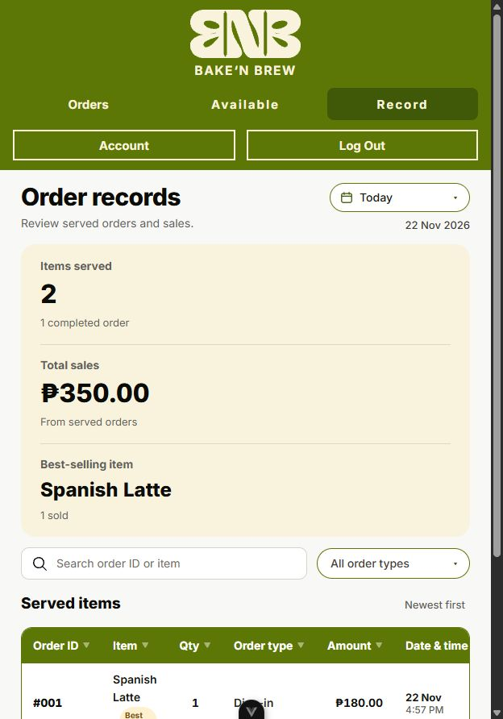

On a narrow screen, scroll the table horizontally if columns are outside the visible area. The export button is below the table.

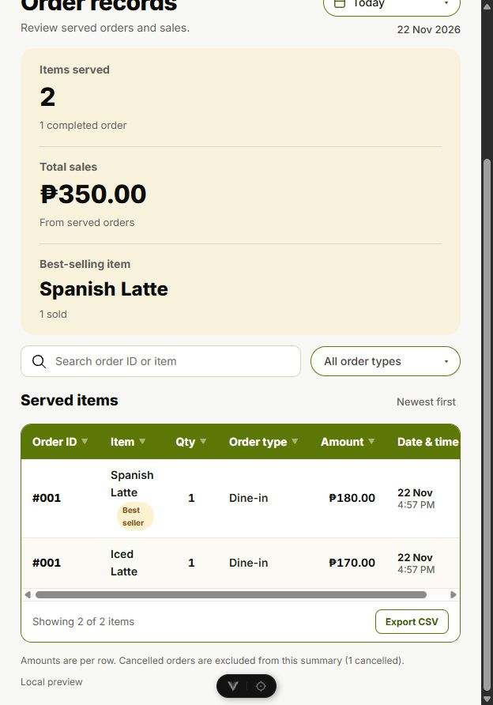

### 7. Manage your account

Select **Account** to view your staff identity and profile. The page also shows your join date and previous login, when available.

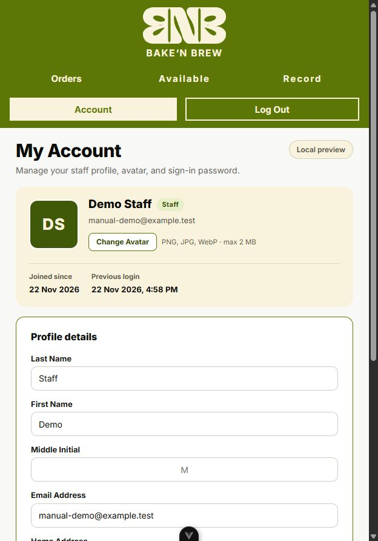

**Update profile details**

1. Edit your last name, first name, middle initial, email address, or home address as needed.
2. Select **Save Changes** and check the on-screen result.
3. Use **Reset** to discard unsaved profile edits and restore the saved values.

**Change your avatar**

1. Select **Change Avatar** and choose a PNG, JPG, or WebP image smaller than 2 MB.
2. Check the preview and select **Save Changes**.
3. To remove an existing avatar, select **Remove Avatar**, then **Save Changes**.

**Change your password**

1. Scroll to **Password & security**.
2. Enter a new password in **Set New Password**, then repeat it in **Confirm New Password**.
3. Meet the displayed requirements: at least eight characters, a letter, a number, and matching entries.
4. Select **Save Password** and check the result. Use the new password for later sign-ins.

Profile changes and password changes have separate save buttons. A save button remains unavailable until there is an eligible change.

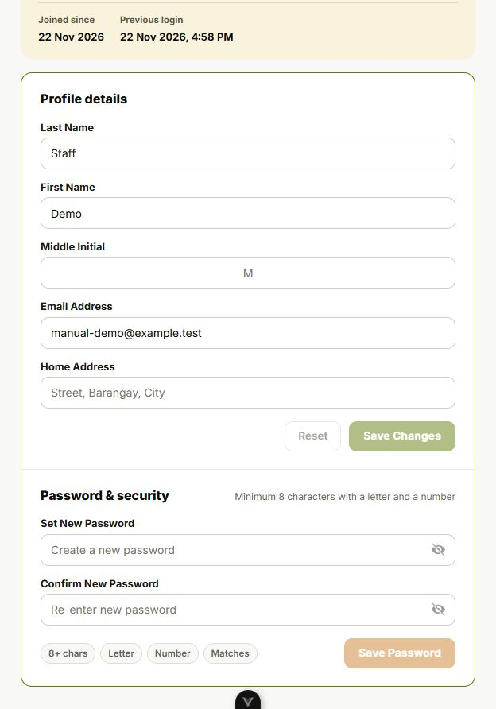

### 8. Sign out

Select **Log Out** in the staff navigation when finished. The application returns to the staff login screen.

## Troubleshooting

| Problem                                                | What to do                                                                                                                                                          |
| ------------------------------------------------------ | ------------------------------------------------------------------------------------------------------------------------------------------------------------------- |
| The application will not open.                         | Ask the demonstrator to confirm the server is running. Use the exact browser address and port shown for that session.                                               |
| View my order is unavailable.                          | Add at least one menu item.                                                                                                                                         |
| Confirm Order, Done, or a save button is not visible.  | Scroll down; longer pages extend below the screen.                                                                                                                  |
| The order remains at Waiting for confirmation/payment. | Complete the cashier's payment check. Staff must select Proceed; waiting does not accept the order automatically.                                                   |
| Staff cannot see a local-preview order.                | Check that both tabs use the same browser profile, address, and port. Open Orders and check WAITING.                                                                |
| The QR code does not show the order on a phone.        | For the local preview, open the tracking link in the same browser. Phone tracking is not supported by this setup.                                                   |
| The QR image is unavailable.                           | Use the Open order tracking link shown in its place.                                                                                                                |
| Tracking shows a connection error.                     | Keep the page open and let it reconnect, or select Check again when shown. It does not resubmit the order.                                                          |
| Staff login or registration fails.                     | Check the email, password, and invitation code. Use the same browser and address as the local account's registration. Read the displayed error before trying again. |
| Records appear empty.                                  | Try All time, clear the search, select All order types, and confirm staff marked an order as served.                                                                |
| A profile or password save button is unavailable.      | Make a valid change. For passwords, satisfy every displayed requirement and match both entries.                                                                     |
| An avatar is rejected.                                 | Choose PNG, JPG, or WebP and keep the file smaller than 2 MB.                                                                                                       |
